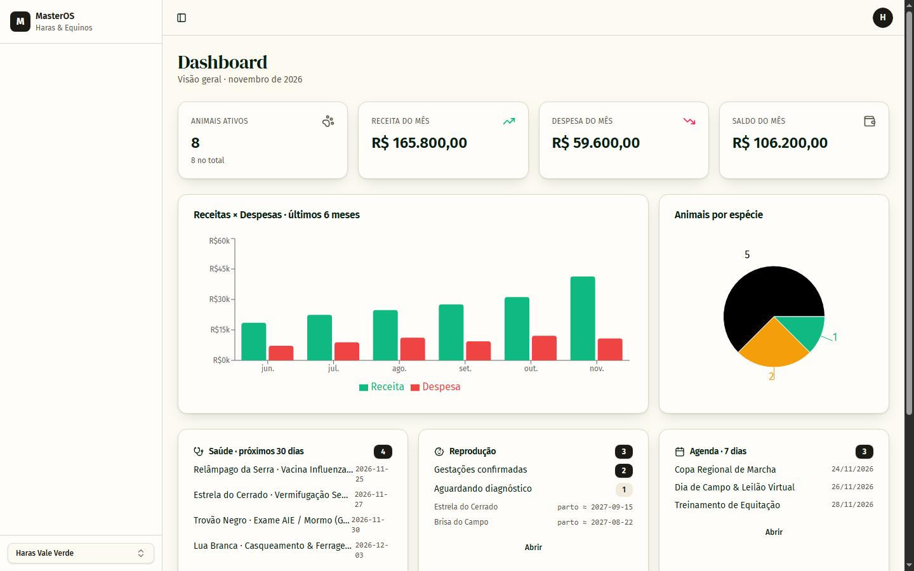

# 🐎 MasterOS · ERP SaaS Multi-Vertical

Plataforma web **SaaS modular multi-tenant** desenvolvida para gestão operacional e financeira de **haras, centros de treinamento, associações e negócios por vertical**, com ativação dinâmica de módulos e dashboard analítico completo.



## ✨ Funcionalidades

- **Dashboard Gerencial:** KPIs de plantel ativo, receita do mês, despesa do mês, saldo, gráficos de receitas × despesas dos últimos 6 meses e distribuição por espécie.
- **Multi-Tenancy & Módulos:** suporte a múltiplas organizações e verticais com habilitação granular de módulos por tenant.
- **Plantel, Saúde & Reprodução:** cadastro completo de animais e documentos, agenda sanitária (vacinas, vermífugos, exames), controle de coberturas e partos.
- **Financeiro & Associados:** lançamentos de receitas/despesas, mensalidades, fechamentos mensais, fornecedores, compras e controle de estoque/silos.

## 🧱 Arquitetura (Web, APIs & SQL)

- **Front-end Web:** `React 19`, `TypeScript`, `TanStack Start`, `TanStack Router`, `TanStack Query`, `Tailwind CSS v4`, `Recharts`, `Radix UI` / `shadcn/ui`
- **Back-end & APIs:** Server Functions para catálogo de módulos e verticalização, APIs REST tipadas e autenticação com controle de acesso por organização
- **Banco de Dados SQL:** PostgreSQL com migrations versionadas e políticas de segurança em **26 tabelas**:
  `verticals`, `modules`, `vertical_modules`, `organizations`, `organization_modules`, `profiles`, `memberships`, `associados`, `mensalidades`, `eventos`, `animais`, `animais_documentos`, `proprietarios`, `fechamentos_mensais`, `fechamento_itens`, `lancamentos`, `silos`, `estoque_itens`, `estoque_movimentos`, `animais_saude`, `reproducao_coberturas`, `reproducao_partos`, `funcionarios`, `fornecedores`, `compras`, `notificacoes`.

## 🚀 Executando localmente

```bash
bun install
bun run dev
```

Build de produção:

```bash
bun run build
```
